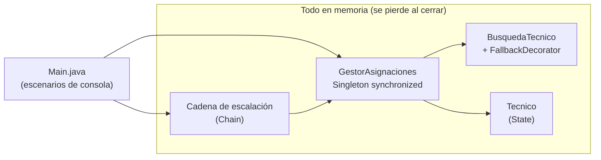
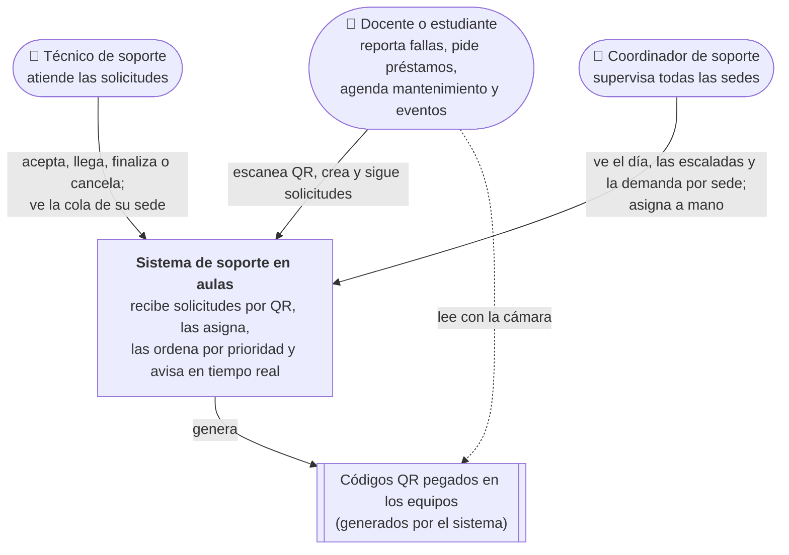
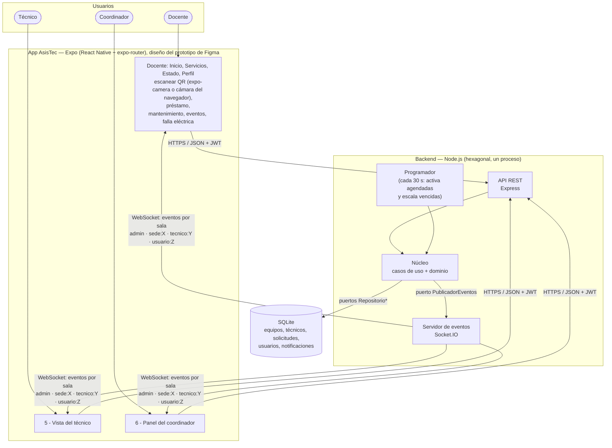
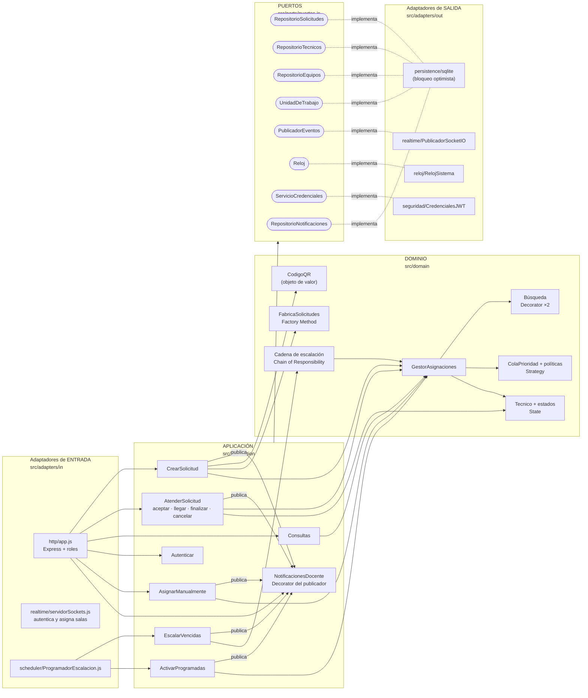

# Documento de arquitectura — Sistema de solicitud de soporte técnico en aulas

**Diseño y Arquitectura de Software (DYAS) · Corte 2**
María José Almanza Caviedes · Pablo Andrés Tamayo González · Amy Jeanine Nossa Ramírez · Simón Martínez García

---

## 1. Descripción del sistema y resumen del Corte 1

En la Universidad de La Sabana cada salón tiene un teléfono para pedir soporte: fallas del video beam, cables, préstamo de portátiles o extensiones. Los atiende un "carrito" que solo existe en algunos edificios. En la práctica muchas llamadas no se contestan, nadie sabe si ya se le asignó la solicitud a alguien, y los edificios sin carrito quedan con demoras largas.

**Qué entregamos en el Corte 1** (código original en [`corte1-java/`](../corte1-java)): un módulo en Java, solo en memoria, que asignaba una solicitud a un técnico disponible. Usaba cuatro patrones:

| Patrón | Uso en el Corte 1 |
|---|---|
| Singleton | `GestorAsignaciones` único con métodos `synchronized` |
| State | ciclo del técnico: Disponible → Asignado → EnCamino → Ocupado |
| Decorator | `FallbackDecorator`: si no hay técnico en el edificio, busca en los cercanos |
| Chain of Responsibility | escalación: técnico asignado → técnico cercano → coordinador |

Lo que el Corte 1 dejó pendiente, dicho por nosotros mismos: no había interfaz, persistencia, roles ni panel del coordinador, y nada disparaba la escalación con el paso del tiempo.

**Qué entrega el Corte 2:** el mismo diseño del Corte 1, llevado a JavaScript clase por clase y ampliado para los retos. Por qué cambiamos de lenguaje, qué alternativas había y qué nos costó está en el [ADR-007](adr/ADR-007-migracion-java-a-node.md), junto con la tabla que muestra a qué reto responde cada pieza del Corte 1. Un backend Node.js con arquitectura hexagonal y una app Expo construida sobre nuestro prototipo de Figma **AsisTec** (18 pantallas: docente, técnico y coordinador), comunicados por HTTP y WebSocket, con datos persistentes en SQLite. La sección 4.7 muestra qué hay detrás de cada pantalla del prototipo.

## 2. Retos asignados y trazabilidad

La tabla de trazabilidad completa (reto → atributo → decisión → dónde está → prueba → resultado) está en el [README](../README.md#tabla-de-trazabilidad-de-retos). Aquí va qué exige cada reto **en términos del sistema**:

| Reto | Qué exige en el sistema |
|---|---|
| Reservar mediante QR | El docente o el estudiante (los dos reservan) no marca un número ni describe dónde está: escanea y en dos toques la solicitud queda creada con la ubicación correcta. Aplica tanto a fallas como a préstamos (reservar un portátil o una extensión para su salón) |
| QR asociado al PC | Cada equipo tiene un identificador único. El QR lleva **solo ese identificador**; la ubicación la resuelve el servidor, así un QR copiado o manipulado no puede "mover" un equipo |
| Enfoque administrativo | Roles con permisos distintos: docente y estudiante piden, técnico atiende, coordinador supervisa. El coordinador ve lo que pasó hoy (escaladas, resueltas, tiempo promedio), la lista de escaladas con su motivo, y puede asignarlas a mano |
| Reporte en tiempo real, cola de prioridades | Los cambios llegan a las pantallas sin recargar. Si no hay técnicos libres, las solicitudes esperan en una cola ordenada por urgencia, y ninguna espera para siempre |
| Multisede (distribución y demanda) | Cada sede tiene su propia cola y sus técnicos. La asignación automática nunca manda a alguien a otra sede; si una sede se satura, el coordinador ve el déficit y puede mandar un técnico de otra sede con "Asignar manualmente" |
| Implementar pruebas | Unitarias, de integración y de carga, ejecutables con un comando |
| Pantalla del trabajador | El técnico ve su solicitud actual, el siguiente paso válido (según el State), puede cancelar si no alcanza a llegar, y ve la cola de su sede |

## 3. Comparación de estilos y decisión

La comparación completa, con matriz de criterios derivados de los retos, está en **[ADR-001](adr/ADR-001-estilo-hexagonal.md)**. En resumen:

| | Capas | **Hexagonal** | Microservicios | Event-driven |
|---|---|---|---|---|
| Puntaje con criterios de los retos | 13 | **17** | 13 | 12 |
| Motivo principal | El negocio termina acoplado a BD y sockets | El núcleo se prueba sin infraestructura, varias entradas y salidas | Desproporcionado para 2 sedes y 4 técnicos, y rompe la asignación atómica | Necesita broker y acepta consistencia eventual en la asignación |

**Decisión:** hexagonal (puertos y adaptadores) en el backend, más una app Expo como cliente.

Otras decisiones registradas:

- [ADR-002](adr/ADR-002-concurrencia-bloqueo-optimista.md): Singleton `synchronized` → bloqueo optimista
- [ADR-003](adr/ADR-003-tiempo-real-y-cola.md): Socket.IO y cola con envejecimiento
- [ADR-004](adr/ADR-004-limite-en-consulta-de-cola.md): paginar la cola, tomada a partir de la prueba de estrés
- [ADR-005](adr/ADR-005-notificaciones-decorator.md): notificaciones del docente como Decorator del puerto de eventos
- [ADR-006](adr/ADR-006-solicitudes-agendadas.md): solicitudes agendadas (estado PROGRAMADA) que entran solas a la cola
- [ADR-007](adr/ADR-007-migracion-java-a-node.md): pasar el módulo del Corte 1 de Java a Node conservando su diseño, con lo que costó y la trazabilidad clase por clase

**Qué mejora y qué sacrifica el estilo:** mejora la testabilidad, la modificabilidad (cambiar el canal de notificación o la BD sin tocar reglas) y la consistencia. Sacrifica simplicidad (más archivos e indirección) y no da escalabilidad horizontal inmediata.

## 4. Arquitectura inicial (Corte 1) y arquitectura evolucionada (Corte 2)

### 4.1 Corte 1: un módulo en memoria

### 4.2 Corte 2: diagrama de contexto (C4 nivel 1)

### 4.3 Corte 2: diagrama de contenedores (C4 nivel 2)

### 4.4 Corte 2: diagrama de componentes del backend (C4 nivel 3)

**Composición:** `src/config/contenedor.js` es el único archivo que conoce las clases concretas de ambos lados, y las pruebas de integración usan esa misma función con SQLite en memoria. Las flechas de dependencia apuntan siempre hacia el dominio, y `tests/unit/arquitectura.test.js` lo verifica.

### 4.5 Correspondencia diagrama ↔ código

| Elemento del diagrama | Carpeta / archivo |
|---|---|
| App Expo | `app/src/app/` (una ruta por pantalla del prototipo), `app/src/ui/` (componentes e iconos exportados de Figma), `app/src/lib/` (sesión, cliente HTTP, tiempo real) |
| API REST | `backend/src/adapters/in/http/app.js` |
| Servidor de eventos | `backend/src/adapters/in/realtime/servidorSockets.js` + `adapters/out/realtime/PublicadorSocketIO.js` |
| Programador (agenda y escalación) | `backend/src/adapters/in/scheduler/ProgramadorEscalacion.js` |
| Casos de uso | `backend/src/application/*.js` |
| Dominio | `backend/src/domain/**` |
| Puertos | `backend/src/ports/puertos.js` |
| SQLite | `backend/src/adapters/out/persistence/sqlite/` |
| Raíz de composición | `backend/src/config/contenedor.js` |

### 4.6 Patrones: del Corte 1 al Corte 2

| Patrón | Corte 1 | Corte 2 |
|---|---|---|
| State | `tecnicos/*.java` | `domain/tecnicos/estados.js`, sin cambios de diseño, más una fábrica para rehidratar desde la BD |
| Decorator | `FallbackDecorator` | `FallbackCercaniaDecorator` + **nuevo** `CualquieraDeLaSedeDecorator` (multisede) |
| Chain of Responsibility | 3 handlers que imprimían en consola | Los mismos 3 handlers, que ahora devuelven un resultado y los dispara **automáticamente** el programador |
| Singleton | `GestorAsignaciones` | **Retirado.** Instancia única por inyección + bloqueo optimista (ADR-002) |
| **Factory Method** (nuevo) | — | `FabricaSolicitudes`: reglas distintas por tipo de solicitud. Los 5 servicios del prototipo son 5 creadores; agregar uno no toca los casos de uso |
| **Decorator** (nuevo uso) | — | `NotificacionesDocente` envuelve el puerto `PublicadorEventos` para guardar los avisos del docente (ADR-005) |
| **Strategy** (nuevo) | — | Política de prioridad intercambiable |
| **Puertos y adaptadores** (nuevo, estilo) | — | Toda la estructura del backend |

### 4.7 Del prototipo de Figma al sistema

La app reproduce las pantallas del prototipo **AsisTec** (tokens de color, tipografía Inter, iconos exportados del archivo de Figma). Cada pantalla que en el prototipo era solo dibujo quedó conectada a un caso de uso:

| Pantalla del prototipo | Ruta en la app | Qué hace de verdad | Caso de uso / endpoint |
|---|---|---|---|
| 1 - Inicio | `(docente)/inicio` | Buscador de servicios, "Tu solicitud activa" en vivo, campana con avisos sin leer | `Consultas.misSolicitudes` · `GET /solicitudes/mias`, `GET /notificaciones` |
| 2 - Elegir tipo de solicitud | `nueva` | Lleva al escáner o al préstamo | — |
| 3a - Escanear QR del equipo | `escanear` | Lee `SOPORTE:v1:<código>` y muestra el equipo detectado. "Buscar manualmente por edificio y salón" cuando el QR no se lee | `GET /qr/resolver`, `GET /ubicaciones`, `GET /equipos` · `CrearSolicitud` |
| *(nueva)* ¿Qué le pasa al equipo? | `falla` | Después de escanear: opciones de problema según el tipo de equipo (video beam, PC…), descripción (obligatoria con "Otro problema") y si hay clase en curso | `GET /equipos/:codigo` (con `problemas`) · `CrearSolicitud` (FALLA_EQUIPO_FIJO, `datos.problema`) · `problemasEquipo.js` |
| 3b - ¿Cuándo lo necesitas? | `cuando` | Ahora o agendado | — |
| 3c - Préstamo (y agendado) + calendario | `prestamo` | Salón, recurso y cantidad, internet, software; fecha y hora con el calendario | `CrearSolicitud` (tipo PRESTAMO_EQUIPO, `programadaPara`) · `ActivarProgramadas` |
| 4 - Seguimiento en tiempo real | `seguimiento/[id]` y pestaña Estado | Pasos Pendiente → Asignada → En camino → Resuelta, técnico con botón de llamada, detalle | `Consultas.estadoSolicitud` + eventos Socket.IO en la sala `usuario:<docente>` |
| 5 - Vista del técnico | `tecnico` | Su estado, la solicitud actual con el único botón válido (aceptar / confirmar llegada / resolver) y "Cancelar"; próximas de la cola | `AtenderSolicitud` · `Consultas.panelTecnico` |
| 6 - Panel del coordinador | `coordinador` | Escaladas hoy, resueltas hoy, tiempo promedio; escaladas con motivo y "Asignar manualmente"; demanda por sede | `Consultas.resumenHoy`, `Consultas.escaladas`, `AsignarManualmente`, `Consultas.demandaPorSede` |
| 7 - Confirmación de envío | `confirmacion` | Número de solicitud consecutivo (#S-0001) | — |
| 8 - Mis solicitudes | `mis-solicitudes` | Activas e historial | `Consultas.misSolicitudes` |
| 9 - Servicios | `(docente)/servicios` | Los 5 servicios | — |
| 10 - Perfil | `(docente)/perfil` | Nombre y correo del usuario, accesos, cerrar sesión | `Autenticar` (perfil) |
| 11 - Notificaciones | `notificaciones` | Avisos guardados de cada cambio de sus solicitudes | `NotificacionesDocente` |
| 12 - Agendar mantenimiento | `mantenimiento` | Tipo de revisión (General, A/C, Mobiliario), fecha y notas | `CrearSolicitud` (MANTENIMIENTO) |
| 13 - Soporte para eventos | `evento` | Nombre, salón o auditorio, fecha y requerimientos (varios) | `CrearSolicitud` (SOPORTE_EVENTO) |
| 14 - Reportar falla eléctrica | `electrica` | Tipo de falla y descripción; se atiende de inmediato | `CrearSolicitud` (FALLA_ELECTRICA) |

Tres cosas que el prototipo no tenía y agregamos: la pantalla de inicio de sesión (con el mismo encabezado del Inicio); la pantalla "¿Qué le pasa al equipo?" entre escanear y enviar, para que el técnico llegue sabiendo qué revisar (las opciones las decide el dominio según el tipo de equipo); y, en el panel del coordinador, la sección "Demanda por sede" que pide el reto multisede. Los campos "Edificio y salón" del prototipo eran texto libre; en la app se eligen de la lista del backend para que una solicitud nunca apunte a un salón que no existe.

## 5. Estrategia de pruebas

Detalle y resultados en **[pruebas.md](pruebas.md)**. En resumen:

| Nivel | Qué prueba | Por qué a ese nivel | Comando |
|---|---|---|---|
| Unitarias (205) | Dominio y casos de uso con fakes, espías y reloj falso. Clases de equivalencia y valores límite (QR, reglas de cada servicio, agenda, aging, tiempos de escalación, "hoy" del panel, límite de cola, quién puede ver cada solicitud, qué problema aplica a cada equipo) | Son las reglas que resuelven los retos; deben poder cambiarse sin miedo | `npm run test:unit` |
| Arquitectura (3) | La regla de dependencia hexagonal | Si el código viola el estilo, el diagrama dejaría de ser verdad | incluida en unitarias |
| Integración (69) | Imagen QR impresa → lector → API; repositorio ↔ SQLite real en memoria; API ↔ casos de uso ↔ BD (un caso por pantalla del prototipo); productor ↔ consumidor Socket.IO reales | Las fronteras del estilo: puertos y adaptadores | `npm run test:integration` |
| Sistema, caja negra (1) | La historia completa de una mañana, solo por HTTP | Demuestra que las piezas juntas atienden los retos | incluida en integración |
| De punta a punta (7) | La app web en Chromium con cámara falsa que transmite un QR impreso: cambiar de usuario entre las 4 cuentas y ver los permisos de cada una, leer QR y reportar, estudiante reserva desde foto del QR, QR ajeno rechazado, técnico ve la solicitud sin recargar | Es la prueba que muestra el reto del QR en la app, no solo en la API | `cd e2e && npm test` |
| Carga (3) | baseline, pico y estrés con k6 | Evidencia del reto de tiempo real bajo carga | `bash perf/correr.sh <prueba>` |
| Escaneo de código | ESLint + reglas de seguridad + reglas de pruebas + regla hexagonal + `npm audit` | Encuentra defectos y violaciones del estilo que las pruebas no buscan | `npm run escaneo` |

## 6. Resultados de las pruebas

- **278 pruebas de Jest, todas pasan** (208 unitarias + 70 de integración y sistema), y **7 de 7 de punta a punta en el navegador**. `npm run retos` muestra la lista de chequeo por reto. La prueba de cada reto, con código y salida, está en [evidencias/evidencia-por-reto.md](evidencias/evidencia-por-reto.md).
- **Escaneo de código** (`npm run escaneo`): 0 hallazgos de ESLint, seguridad ni arquitectura. En el primer escaneo aparecieron 29, dos de ellos defectos reales que se corrigieron con prueba. Ver [evidencias/escaneo-codigo.md](evidencias/escaneo-codigo.md).
- **Cobertura del núcleo** (dominio + aplicación) con solo las unitarias: **98,6 % de líneas y 91,2 % de ramas**. El umbral configurado es 85 % de líneas y 75 % de ramas, y `npm run test:coverage` falla si baja de ahí.
- **Carga (versión final):** el SLO (p95 crear ≤ 500 ms, p95 cola ≤ 300 ms, errores < 1 %) se cumple con holgura en el baseline (p95 crear 7,5 ms, cola 5,6 ms) y en el pico de inicio de clases (p95 crear 21,8 ms, cola 18,6 ms a 30 solicitudes/s, 0 % de errores). Las cifras salen de `perf/resultados/*-resumen.json`. En estrés, el sistema se quiebra alrededor de 140 solicitudes/s. Al conectar el prototipo, esa prueba detectó una regresión (quiebre a ≈97 sol/s) causada por el constructor de `Solicitud`; se corrigió y se volvió a medir. Análisis en [pruebas.md §4](pruebas.md#4-pruebas-de-carga).

## 7. Límites conocidos del diseño y trabajo pendiente para el Corte 3

Lo que **no** resolvimos, o resolvimos a medias:

1. **Un solo proceso y SQLite.** El bloqueo optimista ya soporta varias instancias, pero SQLite es un archivo local. Escalar horizontalmente exige PostgreSQL y volver asíncronos los puertos de repositorio.
2. **La cola se recalcula en cada consulta** (O(n)). Con el límite del ADR-004 aguanta ≈140 solicitudes/s; más allá aparecen timeouts. Lo siguiente sería mantener la cola en memoria y actualizarla con los eventos de dominio.
3. **Sin notificaciones push con la app cerrada.** Los avisos quedan guardados (pantalla Notificaciones) y Socket.IO los empuja mientras la app está abierta, pero con la app cerrada no suena nada. Falta un adaptador de push (Expo Notifications) detrás del mismo puerto `PublicadorEventos`. Además, los avisos no son parte de la transacción: si guardar uno falla, la solicitud igual queda creada y el error solo va al log (ADR-005).
4. **Autenticación básica.** Usuarios locales con clave (scrypt) y JWT de 8 h, sin integración con el directorio institucional y sin cierre de sesión en el servidor.
5. **Pesos de prioridad y mapa de cercanía inventados por el equipo.** No están validados con el área de soporte real. Los datos de sedes, edificios y técnicos son de demostración.
6. **Si un técnico no responde y la solicitud se escala, puede volver a recibir otra al quedar libre.** No se penaliza al técnico que no contesta.
7. **Sin reintento automático** cuando la BD responde `ConflictoConcurrencia`: la app muestra el error.
8. **No hicimos las bonificaciones** (pruebas de UI con Cypress/Selenium y evaluación de UX con SUS).
9. **Para el Corte 3:** pipeline de CI/CD que corra `npm test`, la cobertura y el baseline de k6 en cada push, y análisis de dependencias y secretos (DevSecOps). Por ejemplo, hoy `JWT_SECRET` tiene un valor por defecto de desarrollo.
